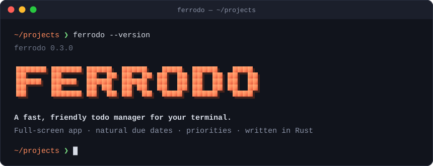
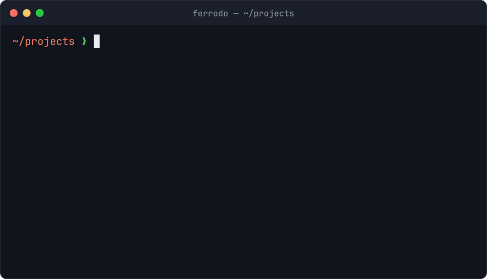
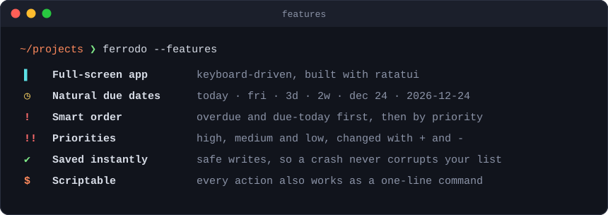
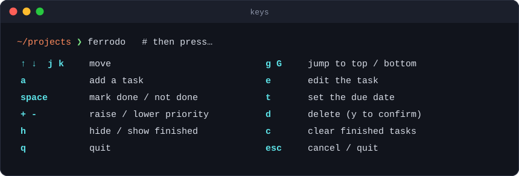

<p align="center">
  
</p>

<p align="center">
  <a href="https://github.com/HemashreeVI/ferrodo/actions/workflows/ci.yml"></a>
  
  
  <a href="LICENSE"></a>
</p>

<p align="center">
  
  <br>
  <sub>25-second demo, recorded from the real app. <a href="assets/demo.mp4">Watch as MP4</a>.</sub>
</p>

<p align="center">
  
</p>

<p align="center"><a href="https://github.com/HemashreeVI/ferrodo/releases/latest"></a></p>

> **No Rust needed:** grab the ready-to-run binary for your system from the [latest release](https://github.com/HemashreeVI/ferrodo/releases/latest), unpack it and run `ferrodo`.

## `❯ install`

You need [Rust](https://rustup.rs) 1.88 or newer.

```bash
cargo install --git https://github.com/HemashreeVI/ferrodo
```

Then run `ferrodo` to open the app.

<p align="center">
  
</p>

## `❯ commands`

Everything the app does also works as a one-line command, which is handy in scripts:

```bash
ferrodo add Buy milk
ferrodo add -p high -d fri "Finish the report"
ferrodo ls            # open tasks
ferrodo ls -a         # include finished tasks
ferrodo done 1 3
ferrodo undo 1
ferrodo edit 2 "Finish the quarterly report"
ferrodo due 2 tomorrow
ferrodo due 2 none    # clear the due date
ferrodo rm 2
ferrodo clear         # delete all finished tasks
```

Due dates can be `today`, `tomorrow`, a weekday (`fri`), an offset (`3d`, `2w`, `1m`), a day of the year (`dec 24`) or a full date (`2026-12-24`).

When the output isn't a terminal (a pipe or a script), plain `ferrodo` prints the list instead of opening the app.

## `❯ storage`

Tasks are saved to `~/.ferrodo.json` after every change. Set `FERRODO_FILE` or pass `--file <path>` to use another file.

## `❯ development`

```bash
cargo test                       # unit tests
cargo clippy --all-targets       # lints
```

Every push and pull request runs formatting, lint and test checks on GitHub for Linux, macOS and Windows, plus a build on the oldest supported Rust (1.88).

The demo and README art are generated, so they stay in sync with the app:

```bash
node demo/record.js              # drives the real app in tmux → assets/demo.gif, demo.mp4
python3 demo/readme_art.py       # terminal-style images → assets/*.svg
```

`record.js` needs tmux, ffmpeg, Node with Playwright, and the JetBrains Mono font.

## `❯ license`

MIT. See [LICENSE](LICENSE).
